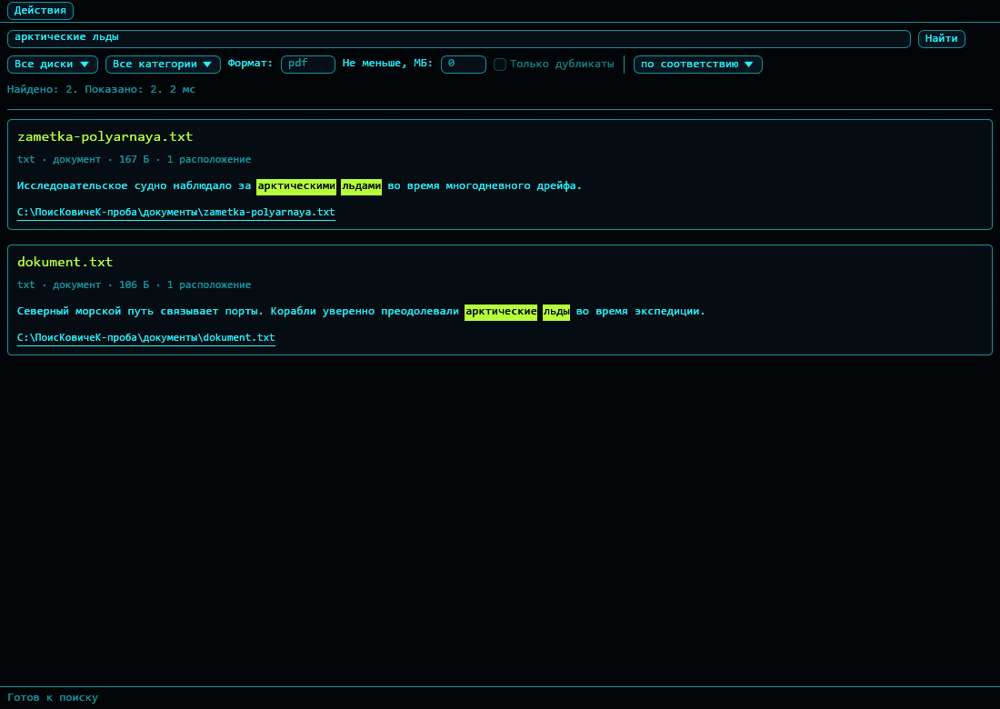

# ПоисКовичеК

Локальный поиск по именам, путям и содержимому документов на Windows 10 и 11 (64-разрядных).
Программа понимает русские словоформы и сохраняет порядок слов при поиске фраз.

**[Скачать для Windows](https://github.com/ivpetr168-hue/poiskovichek-obnovleniya/releases/latest)**

На странице выпуска выберите `Poiskovichek-setup.exe`. Установка для текущего пользователя не требует прав администратора.



## Первый поиск

1. Запустите программу. В мастере первого запуска выберите папку с документами.
2. Нажмите **«Начать индексирование»**. Ход обхода виден в строке состояния.
3. Введите запрос и нажмите **«Найти»**. Например, «арктический лёд» находит и «арктическими льдами».

Для пробы можно выбрать папку [с демонстрационными документами](tests/proba).
В результатах видны путь к файлу и фрагмент текста с совпадением.

## Что можно искать

- **Документы и таблицы** — DOCX, XLSX, PPTX, ODT, ODS, ODP и PDF с текстовым слоем.
- **Книги и текст** — EPUB, FB2, RTF, HTML, TXT, Markdown, CSV и ряд форматов исходного кода.
- **Архивы ZIP** — поиск по поддерживаемым документам внутри архива.

Папки, форматы и расписание повторного обхода описаны в [настройках программы](docs/nastroyki.md).

## Данные и обновления

Индекс, настройки и журналы хранятся на компьютере. Программа пропускает чтение содержимого путей, распознанных как закрытые.
Для переносного режима создайте `settings.toml` рядом с `Poiskovichek.exe`. Данные по умолчанию будут в соседней папке `data`.

Программа обращается к GitHub для проверки новой версии и загрузки выбранного обновления. Манифест версии проверяется по подписи Ed25519.
Локальный поиск и обход папок работают без интернета.

## Сборка из исходников

Нужны Windows x64, Rust 1.98 с целевой платформой MSVC, инструменты сборки Visual C++ и Windows SDK.
Для упаковки установщика нужен Inno Setup 7 с `ISCC.exe` в `PATH`.

В корне проекта выполните:

```powershell
cargo test --locked
cargo build --release --locked --bin Poiskovichek
Copy-Item assets\morph.fst target\release\morph.fst
.\target\release\Poiskovichek.exe
```

Для сборки установщика версии 0.2.1 выполните:

```powershell
.\tools\sobrat-ustanovshik.ps1 -Versiya 0.2.1
```

Установщик появится в `dist\ПоисКовичеК-установка.exe`.

## Обратная связь и лицензии

Об ошибках и предложениях сообщайте во вкладке **Issues** («Задачи»).
Укажите версию программы, версию Windows и шаги воспроизведения. Для примеров используйте демонстрационные файлы.

Код распространяется под [MIT](LICENSE). Данные словаря `morph.fst` — под [CC BY-SA 3.0](assets/ИСТОЧНИК.md).
Сведения о зависимостях приведены в [THIRD_PARTY.md](THIRD_PARTY.md).
